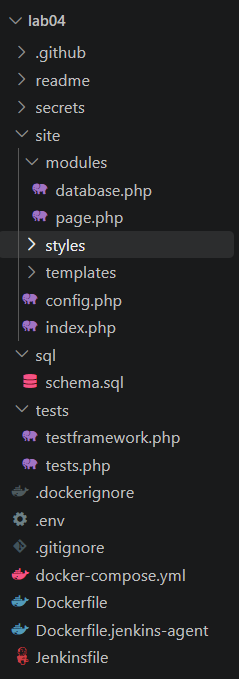
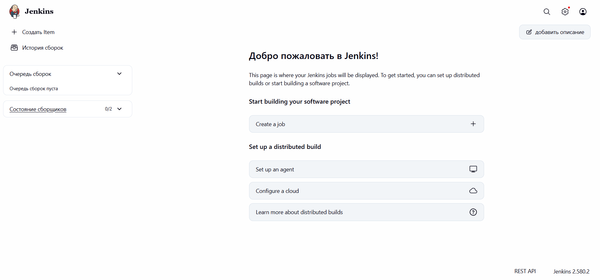
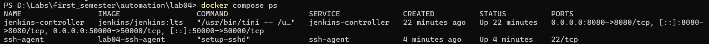
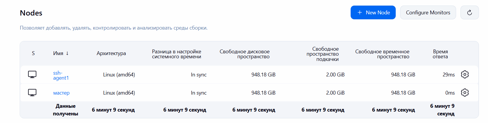
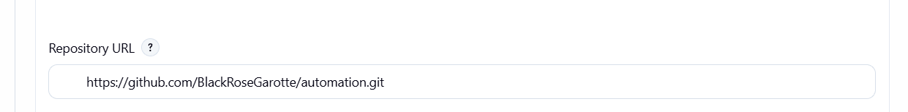
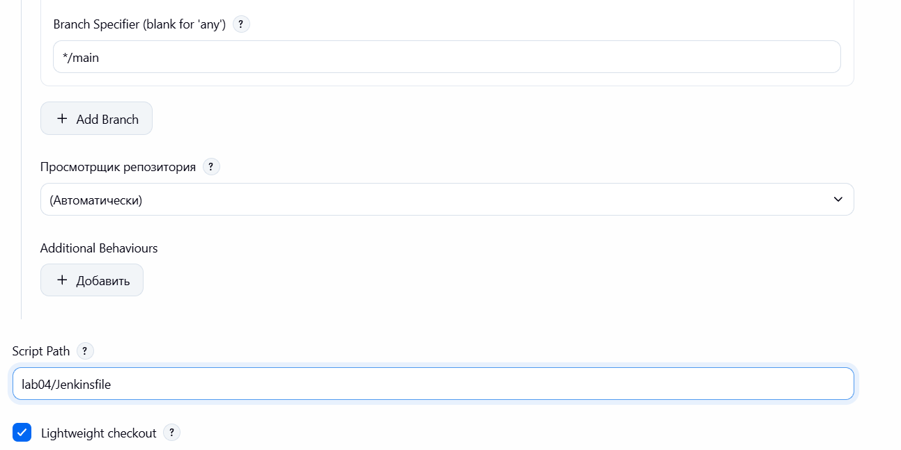
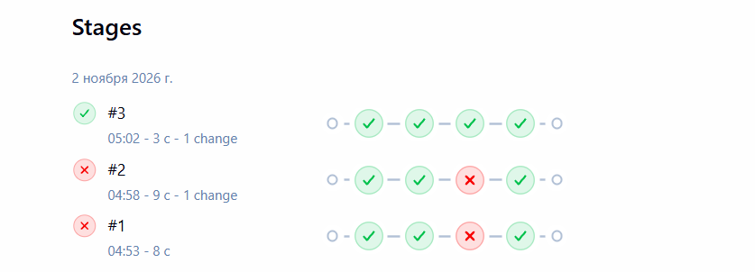

# Jenkins CI/CD Automation

## 1. Project description

The project is a PHP web application that uses SQLite for data storage. It includes classes `Database` and `Page`, providing CRUD operations and HTML template rendering.

The project contains 10 automated tests that verify the functionality of these classes. Jenkins is used to automate testing through a Pipeline running on a separate SSH agent.



## 2. Steps for setting up Jenkins Controller

A `docker-compose.yml` file was created with the `jenkins-controller` service based on the `jenkins/jenkins:lts` image.

The container exposes ports `8080` and `50000`, uses the `jenkins_home` volume for persistent storage, and connects to the `jenkins-network` network.

The controller was started using:

```bash
docker compose up -d
```

The initial administrator password was retrieved, the recommended plugins were installed, and an administrator account was created through the Jenkins web interface.



## 3. Steps for setting up SSH agent

An SSH key pair was generated using `ssh-keygen`. The public key was added to the `.env` file as `JENKINS_AGENT_SSH_PUBKEY`.

A Dockerfile based on `jenkins/ssh-agent` was created with PHP CLI and SQLite support. The `ssh-agent` service was added to Docker Compose.

Both containers were started using:

```bash
docker compose up -d --build
```



The private SSH key was registered in Jenkins Credentials. A permanent agent named `ssh-agent1` was created with the label `php-agent` and connected using SSH.

The initial SSH host key verification problem was resolved by configuring the `Manually trusted key Verification Strategy`.



## 4. Steps for creating and configuring Jenkins pipeline

A `Jenkinsfile` was added to the PHP project in the GitHub repository.

The Pipeline was configured with the following parameters:

- **Repository:** `https://github.com/BlackRoseGarotte/automation.git`
- **Branch:** `main`
- **Script Path:** `lab04/Jenkinsfile`
- **Agent label:** `php-agent`

The Pipeline contains two main stages:

1. **Install Dependencies** - verifies PHP and SQLite and prepares the database.
2. **Test** - executes the PHP unit tests using `php tests/tests.php`.





The Pipeline was configured to report successful or failed execution.



## 5. Control questions

**1. What are the advantages of using Jenkins for DevOps task automation?**

Jenkins automates building, testing, and deployment, reduces manual work and human errors, integrates with Git repositories, supports plugins, and allows tasks to run on separate agents.

**2. What other types of Jenkins agents exist?**

Besides SSH agents, Jenkins supports inbound agents connected through its agent protocol, Docker-based agents, Kubernetes agents created dynamically as pods, and cloud-based agents such as AWS EC2 instances.

**3. What problems did you encounter when setting up Jenkins and how did you solve them?**

The main problem was an SSH connection failure caused by an untrusted SSH host key. It was resolved by configuring the host key verification strategy in Jenkins.

Another issue involved incorrect character encoding in the SSH public key comment. The comment was replaced with ASCII text. The key itself remained valid, so this was not the cause of the connection failure.

After configuring SSH trust, Jenkins successfully authenticated and connected to the agent.